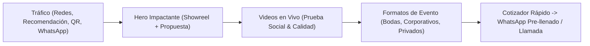

# Plan de Estrategia: Portafolio & Dossier Digital — Ricardo Villarreal Muñoz

Este plan define la estrategia comercial, técnica y de contenido para posicionar a **Ricardo Villarreal Muñoz** frente a clientes potenciales (productoras, wedding planners, empresas y particulares) y convertir visitas en contrataciones directas por **WhatsApp y llamada telefónica**.

---

## 1. Objetivo Comercial: De "Portafolio" a "Dossier de Contratación"

Quien busca un músico para un evento no solo quiere escuchar cómo suena; necesita **confianza, claridad de formatos y facilidad de contacto**. La página funcionará simultáneamente como:
1. **Landing Page de Alta Conversión:** Diseñada para captar el interés en los primeros 5 segundos y llevar al cliente al botón de WhatsApp.
2. **Dossier Artístico (EPK - Electronic Press Kit):** Un enlace único que Ricardo puede enviar por WhatsApp o correo a clientes y productoras con sus mejores videos, fotos, formatos de show y ficha técnica.

---

## 2. Estrategia de Cloud Gratis para Videos y Fotos (\$0 Costo)

Los archivos de video son pesados. Subirlos directamente al servidor web gratuito agotaría el límite de ancho de banda o haría que la página cargue lento en celulares. **La estrategia óptima combina dos servicios gratuitos:**

| Tipo de Contenido | Plataforma Cloud Gratis Recomendada | ¿Por qué usarla? |
| :--- | :--- | :--- |
| **Videos de Presentaciones Complejas / En Vivo (1 a 5 min)** | **YouTube** (Modo *No Listado* o *Público*) | **Ilimitado y 100% gratis.** Ajusta la calidad automáticamente según el internet del cliente. Usaremos reproductores con portada personalizada (*Lazy Load*) para que la web cargue instantáneamente. |
| **Video de Fondo (Hero Loop) + Videos Verticales (Reels) + Fotos HD** | **Cloudinary (Plan Free)** | Otorga **25 créditos mensuales gratis** (~25 GB de almacenamiento/tráfico), comprime videos y fotos automáticamente a formato ligero (`WebP`/`MP4`) y entrega por CDN ultrarrápido sin marcas de agua ni anuncios. |
| **Dossier Descargable (PDF)** | **Alojado en el mismo repositorio (GitHub / Vercel)** | Permite que productoras o clientes descarguen un PDF resumen con un clic. |

> [!TIP]
> **¿Por qué evitar Google Drive para incrustar videos en la web?** Google Drive bloquea frecuentemente la reproducción embebida cuando hay varias visitas seguidas y muestra un reproductor lento en móviles. **YouTube + Cloudinary** garantiza una experiencia profesional y fluida.

---

## 3. Estructura de la Landing Page (Arquitectura de Secciones)

### A. Hero Principal (Primera Impresión)
- **Fondo visual:** Video corto en bucle (sin audio inicial) o fotografía de alto impacto de Ricardo en el escenario con estética elegante (tonos oscuros y acentos dorados/ámbar).
- **Titular claro:** *"Ricardo Villarreal Muñoz — Música en Vivo para Eventos Inolvidables"*.
- **Subtítulo:** Especialidad musical / instrumentos / estilo y cobertura geográfica.
- **Doble Botón de Acción (CTA):**
  1. **Principal:** *"Cotizar Evento por WhatsApp"* (abre chat directo).
  2. **Secundario:** *"Ver Videos en Vivo"* (desplaza suavemente a la galería de videos).

### B. Galería de Videos en Vivo (El Corazón del Portafolio)
- Reproductor destacado con el **Showreel Principal**.
- Grilla de videos filtrable o categorizada (ej. *Eventos Sociales/Bodas*, *Corporativos/Recepción*, *Sesiones en Vivo*).
- Diseño preparado tanto para videos horizontales (16:9) como verticales tipo Reel/TikTok (9:16).

### C. Experiencias y Formatos para Eventos
Tarjetas claras orientadas a lo que el cliente necesita contratar:
- **Matrimonios y Ceremonias:** Música emotiva para ceremonia, cóctel o recepción.
- **Eventos Corporativos y Cenas:** Ambiente sofisticado, volumen ideal para conversar o show estelar.
- **Celebraciones Privadas y Aniversarios:** Repertorio versátil y cercano al público.
- **Qué incluye el servicio:** Puntualidad, repertorio personalizado, opción de amplificación/sonido propio.

### D. Galería Fotográfica & Perfil Artístico (Modo Dossier)
- Biografía breve enfocada en trayectoria, versatilidad y profesionalismo en escenario.
- Galería de fotos tipo *Masonry* con visor a pantalla completa (*Lightbox*).
- **Repertorio Destacado:** Lista o etiquetas de géneros y canciones representativas.
- **Botón "Descargar / Imprimir Dossier":** Opción para guardar la presentación como PDF para enviarla a comités o productoras.

### E. Cotizador Rápido hacia WhatsApp + Llamada Directa
En lugar de un formulario tradicional por correo que nadie responde a tiempo, incluiremos un **Asistente Rápido de Cotización**:
- El cliente selecciona:
  1. **Tipo de evento** (Boda, Corporativo, Cumpleaños/Privado, Otro).
  2. **Fecha aproximada** y **Lugar/Ciudad**.
- Al pulsar **"Enviar a WhatsApp"**, se abre automáticamente el WhatsApp de Ricardo con el mensaje armado:
  > *"¡Hola Ricardo! Vi tu portafolio web y me gustaría cotizar música en vivo para un evento [Tipo] en [Lugar] para la fecha [Fecha]."*
- Además, incluirá un **botón flotante permanente de WhatsApp** y un **botón de Llamada Directa (`tel:`)** en la barra superior e inferior.

---

## 4. Tecnología y Publicación Gratuita

- **Desarrollo:** HTML5 semántico, CSS3 moderno (diseño *Dark Luxury* adaptable a móviles) y JavaScript ligero (cero dependencias pesadas, carga en menos de 1 segundo).
- **Fácil actualización:** Dejaremos una sección de configuración simple en el código donde podrás pegar nuevos enlaces de videos (YouTube o Cloudinary) y fotos en segundos.
- **Hosting Web Gratis (\$0/mes):** Publicación en **Vercel**, **Netlify** o **GitHub Pages** con certificado de seguridad SSL (`https://`) incluido y enlace listo para compartir en Instagram, tarjetas de presentación o WhatsApp Business.

---

## 5. Plan de Ejecución Paso a Paso

1. **Fase 1 — Definición de Datos Clave:** Confirmar teléfono de WhatsApp, estilo/instrumento principal de Ricardo, ciudad/país y si ya tienes algunos videos/fotos listos.
2. **Fase 2 — Construcción de la Landing & Dossier:** Maquetación completa con diseño premium, galería de videos (compatible con Cloudinary y YouTube), galería de fotos, secciones de eventos y generador de mensaje de WhatsApp.
3. **Fase 3 — Carga de Contenido Multimedia:** Configuración de tu cuenta gratuita de Cloudinary/YouTube y enlace de los videos y fotos reales de Ricardo.
4. **Fase 4 — Publicación Online:** Despliegue gratuito para obtener el link público final.
